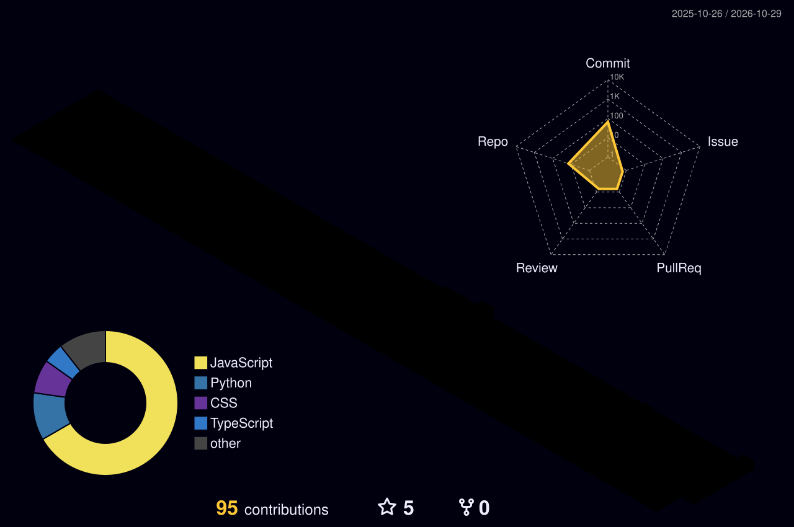

<!-- ═══════════════ HEADER ═══════════════ -->


<div align="center">

<a href="https://github.com/Aditya-Developer19">
  
</a>

<br/>

<a href="https://meetaditya-delta.vercel.app/"></a>
<a href="https://www.linkedin.com/in/aditya-chauhan-96a360248/"></a>
<a href="https://x.com/theaditya09"></a>
<a href="mailto:connect.adityachauhan@gmail.com"></a>
<a href="https://meetaditya-delta.vercel.app/assets/resume.pdf"></a>

<br/><br/>


</div>

<br/>

<!-- ═══════════════ ABOUT ═══════════════ -->


## 🧑‍💻 &nbsp;A Developer *Who Thinks*

```yaml
name        : Aditya Chauhan
location    : Delhi, India 📍
degree      : B.Tech, Information Technology (2023 – 2027)
institute   : Maharaja Surajmal Institute of Technology, GGSIPU
cgpa        : 8.6 / 10

role        : AI Engineer Intern @ Flikt Technology Web Solution
focus       :
  - Full-Stack   →  MERN · FastAPI · REST APIs · JWT Auth
  - Agentic AI   →  LangGraph · CrewAI · MCP · RAG · Vector DBs
  - LLM APIs     →  OpenAI · Gemini · Claude (multi-provider workflows)

now         : building AI-powered tools & full-stack products
open_to     : internships · collaborations · open-source
fun_fact    : "Athlete by build, critical thinker by default 🏃"
```

<br/>

<!-- ═══════════════ TECH STACK ═══════════════ -->


## ⚙️ &nbsp;Tech Stack

<div align="center">

**🤖 Agentic AI**


<br/><br/>

**💻 Languages · 🌐 Frontend · 🔧 Backend · ☁️ DevOps**

<br/>
<br/>
<br/>


</div>

<br/>

<!-- ═══════════════ 3D CONTRIBUTIONS ═══════════════ -->


## 🧊 &nbsp;My Contributions, in 3D

<div align="center">



<br/><br/>


</div>

<br/>

<!-- ═══════════════ STATS ═══════════════ -->


## 📊 &nbsp;GitHub Stats

<div align="center">


<br/>


<br/><br/>


</div>

<br/>

<!-- ═══════════════ EXPERIENCE ═══════════════ -->


## 💼 &nbsp;Experience

| | Role | What I did |
|:-:|:--|:--|
| **2026** | **AI Engineer Intern**<br/>Flikt Technology Web Solution · New Delhi | Shipped AI features with GenAI & LLMs · Built multi-provider workflows across **OpenAI, Gemini & Claude** · Made chatbots & automation flows in agile sprints |
| **2026** | **Full Stack MERN Intern**<br/>IBM – CETPA · Delhi | 6-week on-site MERN program · Built REST APIs & explored AI-driven features |

<br/>

<!-- ═══════════════ ACHIEVEMENTS ═══════════════ -->


## 🏆 &nbsp;Wins & Certs

<div align="center">

<br/>
<br/>
<br/>


</div>

<br/>

<!-- ═══════════════ CONTACT ═══════════════ -->
<div align="center">

### 🤝 &nbsp;Let's build something

<a href="https://meetaditya-delta.vercel.app/"></a>
<a href="mailto:connect.adityachauhan@gmail.com"></a>

</div>


